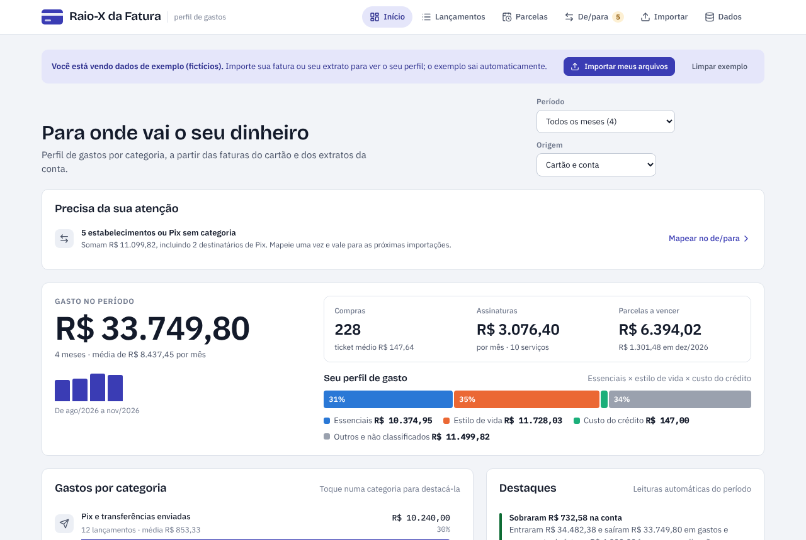
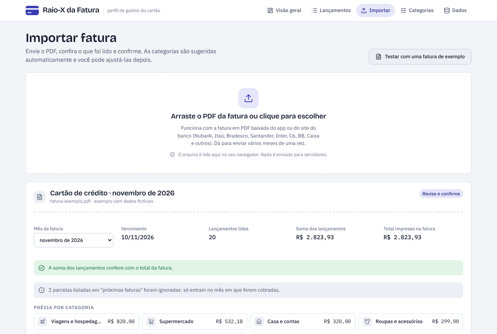
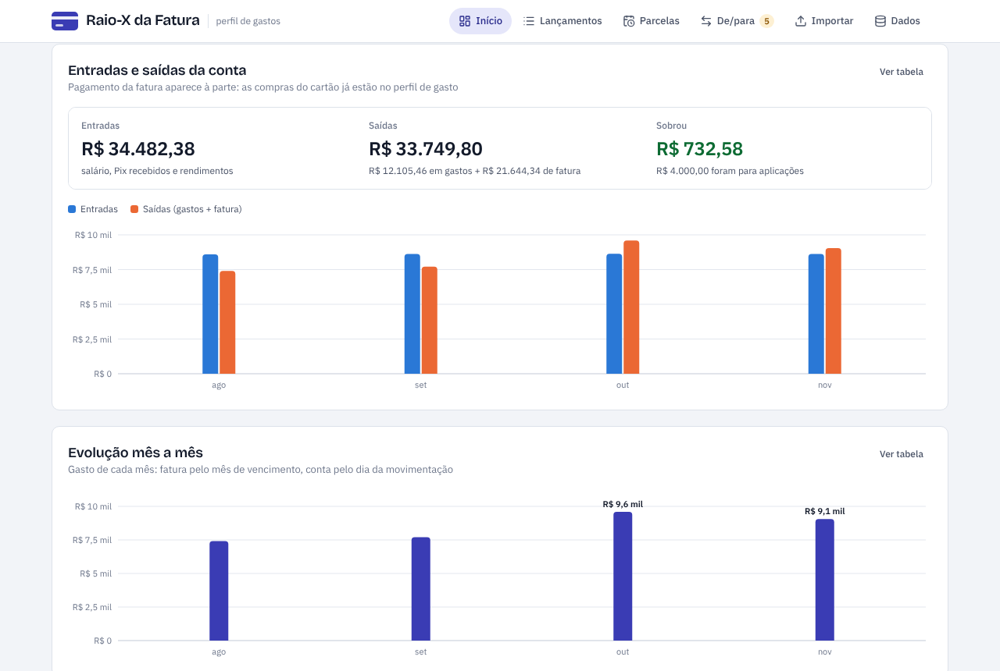
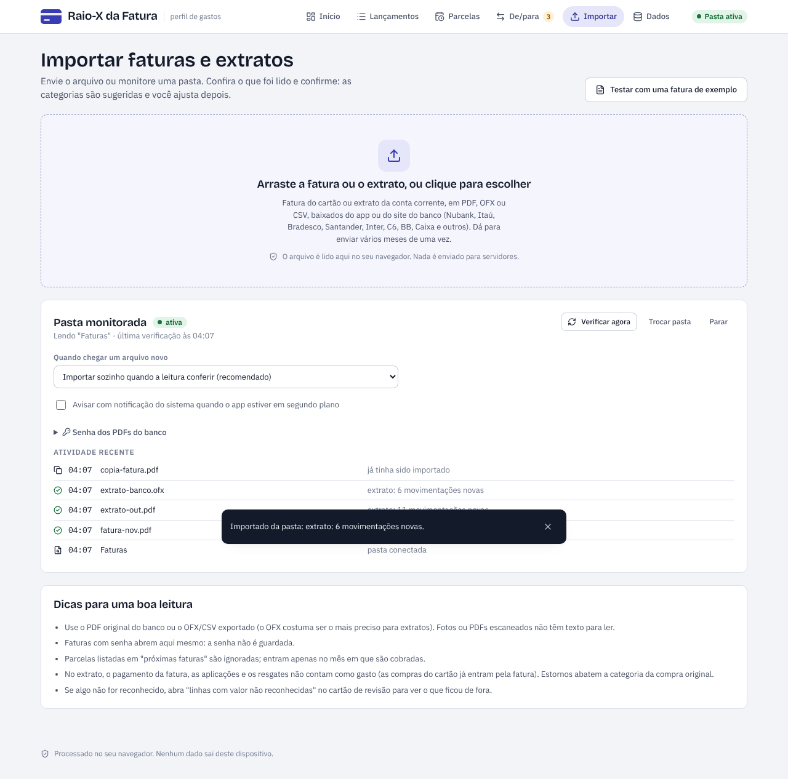
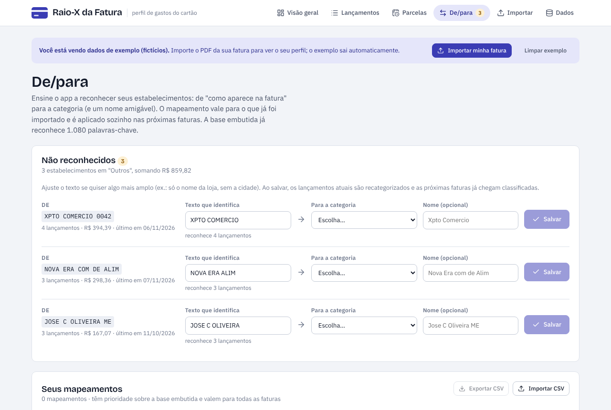
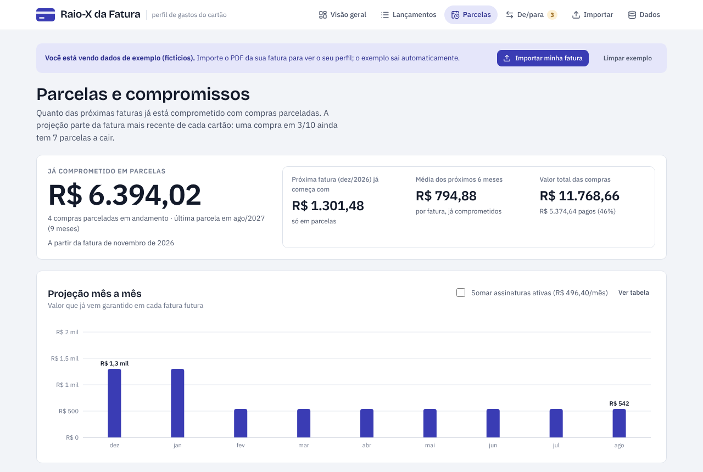

# Raio-X da Fatura

Importe a **fatura do cartão de crédito** e o **extrato da conta corrente** (PDF, OFX ou CSV), ou deixe uma
**pasta monitorada** importar sozinha cada arquivo novo, e veja para onde vai o seu dinheiro: gasto por categoria
(supermercado, restaurantes, delivery, apps de mobilidade, streaming e mais 15), perfil essenciais × estilo de
vida × custo do crédito, entradas e saídas da conta, assinaturas recorrentes, parcelas a vencer e evolução mês a mês.

**Tudo roda no aparelho.** Os arquivos são lidos localmente e nenhum dado é enviado a servidores.

**Abrir o app:** https://luizneogrid-commits.github.io/Despesas/ (funciona no celular e pode ser instalado na tela inicial).



## Funcionalidades

| Área                          | O que faz                                                                                                                                                                                                                                                                                                                                                                                                                                                                                                                                                                                                      |
| ----------------------------- | -------------------------------------------------------------------------------------------------------------------------------------------------------------------------------------------------------------------------------------------------------------------------------------------------------------------------------------------------------------------------------------------------------------------------------------------------------------------------------------------------------------------------------------------------------------------------------------------------------------- |
| **Importação**                | PDF, **OFX/QFX** e **CSV**; arrastar e soltar, vários arquivos de uma vez, PDFs com senha (a senha não é guardada), detecção de arquivo duplicado e de fatura reemitida, **conferência automática** (fatura: soma × total impresso; extrato: saldo anterior + movimentações = saldo final).                                                                                                                                                                                                                                                                                                                    |
| **Extrato de conta corrente** | Data só no primeiro lançamento do dia, descrição em duas linhas (destinatário do Pix), coluna de saldo, sinais `-`/`+`/`D`/`C` ou nenhum (deduzido pela variação do saldo). **Entradas** (salário, Pix recebido, rendimentos) não contam como gasto; **pagamento da fatura**, aplicações e resgates são neutros (não há contagem dupla com a fatura). Extratos sobrepostos não duplicam movimentações (por FITID no OFX ou data+valor+descrição).                                                                                                                                                              |
| **Pasta monitorada**          | Chrome/Edge no computador: escolha a pasta uma vez; cada PDF/OFX/CSV salvo nela é lido e **importado sozinho** quando a leitura confere (ou fica na fila de revisão, conforme a preferência). Importa ou ignora o que já estava lá, detecta cópias, aceita senha padrão dos PDFs (opcional, guardada só se você pedir), registro de atividade e notificação do sistema.                                                                                                                                                                                                                                        |
| **Leitura robusta**           | Datas `09 OUT`, `09/10` e `09/10/2026`; layouts de **uma ou duas colunas**; parcelas (`03/10`, `PARC 2/6`, `Parcela 2 de 6`); créditos (`-R$`, `45,90-`, `45,90 C`); cartões adicionais (`final 1234`, `•••• 1234`); compras internacionais e IOF; ignora o bloco de **"próximas faturas"**; infere o ano na virada (compra de dezembro na fatura de janeiro, parcela 11/12 do ano anterior).                                                                                                                                                                                                                  |
| **Categorização**             | Base embutida com mais de 1.000 palavras-chave de estabelecimentos brasileiros, com marcas (iFood, Uber, 99, Netflix, Carrefour…). Remove intermediadores (`PAG*`, `MP*`, `PAYPAL *`, `EC *`). Plataformas de delivery vencem o nome do restaurante (`IFD*PIZZARIA` é delivery).                                                                                                                                                                                                                                                                                                                               |
| **De/para**                   | Tela com os estabelecimentos **não reconhecidos** (que caíram em "Outros"), agrupados, com prévia de quantos lançamentos cada texto reconhece. Você mapeia **de** "como aparece na fatura" **para** categoria e, se quiser, um nome amigável. O mapeamento recategoriza o que já foi importado e é **aplicado automaticamente nas próximas faturas** (inclusive na tela de revisão da importação, onde também dá para mapear antes de confirmar). Tipos: contém, começa com, exato e regex. Exportação/importação do de/para em CSV. Corrigir a categoria de um lançamento também oferece "Salvar no de/para". |
| **Análises**                  | Ranking de categorias com variação vs. período anterior, perfil por grupo, evolução por fatura com destaque da categoria, onde você mais gasta, assinaturas detectadas por recorrência, parcelas futuras por mês e destaques automáticos (comer fora, corridas por app, juros e IOF, gasto de fim de semana, itens sem categoria).                                                                                                                                                                                                                                                                             |
| **Parcelas**                  | Projeção do **valor já comprometido** com parcelas futuras: total a pagar, quanto a próxima fatura já começa devendo, média dos próximos 6 meses, gráfico/tabela mês a mês (opcionalmente somando assinaturas ativas), andamento de cada compra (já pago, falta, termina em) e "quando a fatura fica mais leve". A projeção parte da fatura mais recente **de cada emissor**, para não misturar cartões com meses diferentes.                                                                                                                                                                                  |
| **Dados**                     | Persistência local (IndexedDB), exportação CSV no padrão do Excel em português (`;`, vírgula decimal, BOM UTF-8, proteção contra injeção de fórmulas), backup/restauração em JSON, remoção por fatura ou total.                                                                                                                                                                                                                                                                                                                                                                                                |
| **Primeiro acesso**           | Abre com dados de exemplo (fictícios, sinalizados); a primeira fatura real os substitui. Há também um PDF de exemplo para testar a importação de ponta a ponta.                                                                                                                                                                                                                                                                                                                                                                                                                                                |











## No celular

O Raio-X é um **PWA** (Progressive Web App): abre pelo navegador e pode ser instalado como um app comum,
sem loja.


|                       | Android (Chrome, Edge, Samsung Internet)                                                                      | iPhone/iPad (Safari)                                               |
| --------------------- | ------------------------------------------------------------------------------------------------------------- | ------------------------------------------------------------------ |
| **Instalar**          | Abra o endereço e toque em **Instalar app** (no topo ou em Dados), ou no menu ⋮ → _Instalar app_              | Abra no Safari → **Compartilhar** → **Adicionar à Tela de Início** |
| **Importar a fatura** | Toque em **Importar** e escolha o PDF, ou, no app do banco/gerenciador de arquivos, **Compartilhar → Raio-X** | Toque em **Importar** e escolha o PDF em Arquivos                  |
| **Sem internet**      | Funciona offline depois da primeira abertura, inclusive a leitura do PDF                                      | Idem                                                               |

Como foi feito:

- **Interface mobile-first**: barra de abas inferior (Início, Lançamentos, Importar, Parcelas, De/para), alvos de
  toque de 44 px, campos com 16 px (sem zoom automático no iOS), áreas seguras do entalhe e da barra de gestos,
  filtros recolhíveis, tabelas que viram cartões, tema claro/escuro do sistema.
- **Manifesto** (`public/manifest.webmanifest`): nome, ícones (inclusive _maskable_), cor do tema, atalhos
  (Importar, Parcelas, De/para), **Web Share Target** para receber PDFs e **File Handling** para abrir PDFs no
  computador com o app instalado.
- **Service worker** (`scripts/sw.template.js` → `dist/sw.js`): guarda o app inteiro em cache (cerca de 2,2 MB,
  incluindo o leitor de PDF), atende tudo offline e trata o `POST` do compartilhamento. O PDF compartilhado fica
  num cache local só até o app importá-lo. A lista de arquivos e a versão são geradas no build a partir do
  conteúdo; quando há versão nova, o app mostra **"Atualizar"** em vez de recarregar sozinho no meio de uma revisão.
- **Hospedagem**: GitHub Pages, publicado pelo workflow `.github/workflows/deploy.yml` a cada push na `main`
  (roda os testes antes). Os caminhos são relativos, então o app funciona em `/Despesas/` ou em qualquer subpasta.
  Na primeira vez, ative em **Settings → Pages → Build and deployment → Source: GitHub Actions** e rode o
  workflow de novo (Actions → _Publicar no GitHub Pages_ → _Re-run all jobs_).

## Como rodar

Requisitos: Node.js 20+ (recomendado 22, ver `.nvmrc`).

```bash
npm ci
```

```bash
npm run dev
```

Abra o endereço mostrado (normalmente http://localhost:5173).

| Comando                                                       | Para quê                                                                       |
| ------------------------------------------------------------- | ------------------------------------------------------------------------------ |
| `npm run dev`                                                 | Servidor de desenvolvimento                                                    |
| `npm run build`                                               | Build de produção em `dist/` (estático, funciona em qualquer subpasta)         |
| `npm run preview`                                             | Serve o build de produção localmente                                           |
| `npm test`                                                    | Testes (Vitest)                                                                |
| `npm run coverage`                                            | Testes com cobertura                                                           |
| `npm run lint` / `npm run typecheck` / `npm run format:check` | Qualidade                                                                      |
| `npm run fixtures`                                            | Regenera os PDFs fictícios usados nos testes                                   |
| `npm run icons`                                               | Regenera os ícones PNG a partir de `public/icons/*.svg` (requer Playwright)    |
| `npm run build:artifact`                                      | Página única com JS, CSS e fontes embutidos (para hospedagem com CSP restrita) |

### Docker

```bash
docker build -t raio-x-fatura .
```

```bash
docker run --rm -p 8080:8080 raio-x-fatura
```

A imagem final é só nginx (sem privilégios) servindo arquivos estáticos, com CSP restrita
(`default-src 'self'`), `nosniff`, `no-referrer` e `Permissions-Policy` (ver `security-headers.conf`).

## Arquitetura

SPA em **React 19 + TypeScript (strict)**, empacotada com **Vite**. Sem backend. O domínio é TypeScript puro,
testável sem navegador; a UI só consome funções puras.

```
src/
├── domain/           tipos, dinheiro em centavos (inteiros), datas e categorias
├── parsing/          PDF → linhas → lançamentos
│   ├── pdf.ts          carrega pdf.js (worker de mesma origem, import dinâmico)
│   ├── extract.ts      itens de texto posicionados por página
│   ├── lines.ts        reconstrói linhas e detecta layout em duas colunas
│   ├── tokenize.ts     DATA / VALOR / TEXTO
│   ├── parseStatement.ts  fatura: máquina de estados, seções, parcelas, ano, tipo
│   ├── parseAccount.ts    extrato de conta: data do dia, continuação, saldo, sinal
│   ├── ofx.ts / csvStatement.ts  OFX (SGML/XML, conta e cartão) e CSV por cabeçalho
│   └── metadata.ts     emissor, tipo de documento, vencimento, período, saldos, total
├── categorization/   normalização, base embutida e motor de regras
├── analytics/        agregações, assinaturas, projeção de parcelas e compromissos, destaques
├── services/         importação (rascunho → revisão), de/para, exportação, dados de exemplo
├── storage/          IndexedDB com migração de schema e fallback em memória
├── store/            estado global (Zustand) e persistência com debounce
├── pwa/              service worker, instalação, arquivos recebidos e pasta monitorada
└── ui/               páginas, gráficos SVG próprios e componentes
```

### Pipeline de leitura

1. **pdf.js** extrai fragmentos de texto com posição (x, y). Nada é renderizado e o PDF não executa scripts.
2. **Linhas**: fragmentos são agrupados por y com tolerância proporcional à fonte e ordenados por x.
   Se várias linhas têm um valor seguido de uma data após um vão, a página é tratada como **duas colunas**
   e a coluna da esquerda é lida inteira antes da direita.
3. **Tokens**: cada linha vira uma sequência de `DATA`, `VALOR` e `TEXTO` (valores são mascarados antes de
   procurar datas, para não confundir `1.234,56` com `12.34`).
4. **Máquina de estados**: reconhece `DATA [DATA] TEXTO [PARCELA] VALOR…`, inclusive vários lançamentos na
   mesma linha. Uma data `dd/mm` entre a descrição e o valor é uma parcela.
5. **Contexto**: cabeçalhos mudam o estado (cartão atual, seção internacional, bloco de próximas faturas).
   Linhas sem data logo após um lançamento anexam informações a ele (parcela, valor em dólar).
6. **Classificação**: pagamento, estorno, encargo ou compra. **Ano** inferido pelo vencimento.
7. **Revisão**: o usuário vê a conferência com o total da fatura, o mês de referência (editável), a prévia por
   categoria e as linhas com valor que não foram reconhecidas, antes de confirmar.

### Decisões e boas práticas aplicadas

- **Privacidade por padrão (LGPD)**: processamento 100% local, sem analytics, sem fontes ou scripts de
  terceiros (fontes auto-hospedadas), senha do PDF nunca persistida, `Referrer-Policy: no-referrer`.
- **Dinheiro em centavos inteiros**: nenhum cálculo com float.
- **Mês de referência = mês de vencimento da fatura**, como os bancos nomeiam as faturas. Parcelas contam no
  mês em que são cobradas.
- **Conferência automática** da soma lida com o total impresso: o usuário sabe quando confiar na leitura.
- **Regras explicáveis**: cada lançamento guarda a origem da categoria (base embutida, seu de/para, manual,
  padrão). A palavra-chave mais específica vence; o de/para do usuário sempre vence; ajustes manuais nunca são
  sobrescritos. O de/para casa tanto com a descrição quanto com a chave do estabelecimento (sem números e
  palavras como "LTDA"/"DE"), então "LOJA MOVEIS" reconhece "LOJA DE MOVEIS 12".
- **Carregamento sob demanda**: o pdf.js (cerca de 450 kB) só é baixado ao importar.
- **Acessibilidade**: navegação por teclado, foco visível, gráficos com rótulos acessíveis e tabela
  equivalente, cores de gráfico validadas para daltonismo, `prefers-reduced-motion`, tema claro e escuro.
- **Dataviz**: barras horizontais ranqueadas numa cor para comparar categorias; destaque (ênfase) em vez de
  arco-íris; eixo único; rótulos seletivos.
- **Qualidade**: TypeScript estrito (`noUncheckedIndexedAccess`), ESLint, Prettier, CI no GitHub Actions,
  testes unitários e **testes de integração com PDFs reais** (fictícios) em três layouts.

## Navegação e UX

A navegação foi revisada numa avaliação heurística (Nielsen + padrões mobile + WCAG de navegação), registrada em
[`docs/avaliacao-ux.md`](docs/avaliacao-ux.md). Em resumo: barra inferior com no máximo cinco abas e "Mais";
painel **Precisa da sua atenção** no Início; **filtros globais** (período, origem cartão/conta, cartão)
compartilhados entre as telas; chips dos filtros ativos com **Voltar**; estabelecimentos e meses clicáveis;
título da aba e foco atualizados a cada tela, "Pular para o conteúdo", atalho **/** para buscar e **Desfazer**
ao remover um documento.

## Como estender

### Ensinar um novo estabelecimento

Edite `src/categorization/builtinRules.ts`. Cada entrada é `"PALAVRA1|PALAVRA2=Marca"`, já normalizada
(maiúsculas, sem acento). `*` no fim casa como prefixo; `!` no início marca uma plataforma intermediária que
vence o nome do lojista. Rode `npm test` e, se quiser, acrescente um caso em
`src/categorization/categorizer.test.ts`.

### Suportar um layout de fatura diferente

1. Gere um PDF de teste **com dados fictícios** reproduzindo o layout em `scripts/generate-fixtures.mjs`.
2. Escreva o teste em `tests/pdf-integration.test.ts` (o total lido deve bater com o total declarado).
3. Ajuste `tokenize.ts` (formatos de data e valor), `parseStatement.ts` (seções e palavras-chave) ou
   `metadata.ts` (rótulos de vencimento e total).

A tela de revisão mostra as linhas com valor que não foram reconhecidas: é o melhor ponto de partida
para diagnosticar um banco novo.

## Limitações conhecidas

- PDFs **digitalizados** (imagem) não têm texto; seria preciso OCR (fora do escopo, por desempenho e privacidade).
- Não há MCC (código de categoria do lojista) na fatura em PDF; a categorização depende do nome impresso.
  Estabelecimentos genéricos (ex.: "XPTO COMERCIO") caem em "Outros" até você mapeá-los uma vez no de/para.
- Em compras internacionais com colunas em reais e dólar, assume-se que o último valor da linha é o valor
  em reais.
- Os dados ficam no navegador: limpar os dados do site apaga tudo. Use o backup.
- A **pasta monitorada** depende da File System Access API: funciona no Chrome e no Edge do computador, só
  enquanto o app está aberto (aba ou instalado), e o navegador pode pedir para confirmar o acesso a cada visita.
  No celular, use o Compartilhar (Android) ou o botão Importar.
- Em extratos em PDF sem sinal e sem coluna de saldo, entrada/saída é deduzida pela descrição; a revisão avisa
  quantas movimentações estão nessa situação. OFX é o formato mais preciso para conta corrente.

## Próximos passos sugeridos

- Orçamento mensal por categoria com alertas.
- Publicar nas lojas (Google Play via TWA/Bubblewrap ou Capacitor; App Store via Capacitor).
- Sincronização opcional criptografada ponta a ponta entre dispositivos.
